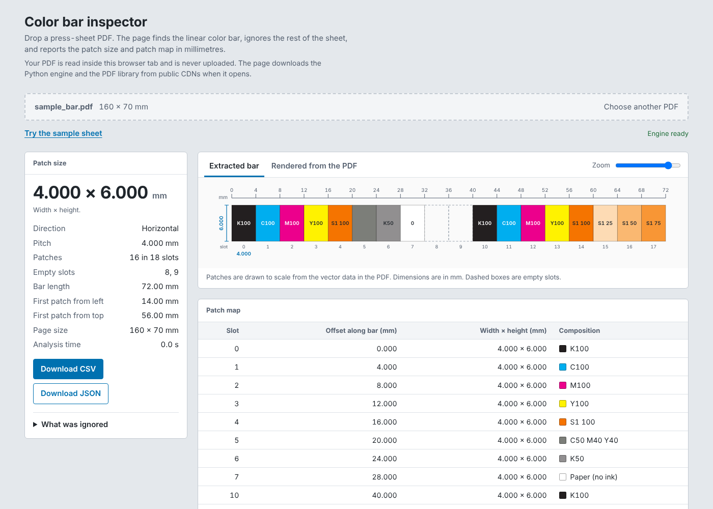

# Color bar inspector

Find the linear color bar in a press-sheet PDF and get the **patch size** and the
**patch map** in millimetres. Built for recreating a color bar template in color
control software, so the system knows how to map measurement data to each patch.

**Live page:** `https://YOUR-USERNAME.github.io/colorbar-inspector/`
(available after you enable GitHub Pages, see [Publishing](#publishing-on-github-pages))



*The bundled sample sheet, which is synthetic. It has one real color bar surrounded by decoy artwork.*

## What it reports

- Patch width and height in mm, the pitch, the patch count and the empty slots
- Where the bar starts on the sheet (mm from the left and from the top)
- Every patch with its offset along the bar and its composition, for example
  `K100`, `C100 M100`, `C50 M40 Y40`, `S1 75`
- Spot colors are labeled `S1`, `S2`, ... in order of appearance. Ink names and
  CMYK alternates are deliberately not shown.
- A preview of the extracted bar, drawn to scale, and optionally the same area
  rendered from the PDF
- CSV and JSON downloads

Horizontal and vertical bars are both supported. A bar can sit on a large sheet
with packaging artwork, dielines and registration marks around it. Those are ignored.

## Privacy

The page runs the analysis **inside your browser tab** (Python compiled to
WebAssembly). Your PDF is never uploaded. When the page opens it downloads the
Python engine ([Pyodide](https://pyodide.org)) and the [pypdf](https://pypi.org/project/pypdf/)
library from public CDNs, and the optional preview tab loads
[pdf.js](https://mozilla.github.io/pdf.js/) the same way. None of those requests
contain your file.

## How the bar is found

1. Every filled rectangle is collected with its size, position and ink. Images,
   text, curved shapes and shapes in production inks (dieline, registration
   `All`, cut, crease, ...) are set aside.
2. Rectangles of the same size are grouped. A color bar is a group on one
   straight line, advancing by a constant pitch, with at least three different fills.
3. The best-scoring line wins. Smaller rectangles inside its outline, such as a
   tint ladder stacked in one cell, are attached as sub-patches.

Ink names in the PDF decide what counts as production artwork, which is why this
works on separations and spot colors and not only on plain CMYK.

## Limits

- The bar must be live vector artwork. A bar placed as an image, or converted to
  outlines, cannot be read.
- Spot-color preview swatches are approximate. The patch map does not depend on them.
- Rotated pages are reported in unrotated page coordinates.
- Coating plates (varnish) are numbered like spot colors and flagged with a warning,
  because a densitometer usually does not read them.
- Very large sheets are slower in the browser than on the command line. An 87 MB
  press sheet takes about 9 seconds with the command-line tool.

## Run it locally

The page needs to be served over HTTP (browsers block module workers on `file://`):

```bash
python tools/build_site.py
python -m http.server -d _site 8000
# open http://localhost:8000
```

It still downloads Pyodide and pypdf from the CDNs, so it needs internet access.

### Command line

```bash
pip install -r requirements.txt
python colorbar_inspector.py sheet.pdf          # readable summary
python colorbar_inspector.py sheet.pdf --json   # everything as JSON
python colorbar_inspector.py sheet.pdf --csv    # patch map as CSV
```

### As a library

```python
import colorbar_core as core

result = core.analyze("sheet.pdf")          # or bytes, or an open binary file
bar = result["candidates"][0]
print(bar["patch_w_mm"], bar["patch_h_mm"], bar["pitch_mm"])
```

## Repository layout

| Path | What it is |
|---|---|
| `colorbar_core.py` | The engine. Pure Python plus pypdf. The same file runs under CPython and in the browser. |
| `colorbar_inspector.py` | Command-line wrapper |
| `site/` | The web page: `index.html`, `style.css`, `app.js`, `worker.js` |
| `tools/build_site.py` | Assembles `_site/` (page + engine + sample) for hosting |
| `tests/` | Unit tests, the synthetic sample generator, and a browser test |
| `.github/workflows/` | Tests and the GitHub Pages deployment |

## Development

```bash
pip install -r requirements-dev.txt
python -m pytest -q tests --ignore=tests/e2e     # unit tests
python tests/make_sample.py                      # regenerate tests/sample/sample_bar.pdf
```

The browser test downloads Pyodide, so it needs internet access:

```bash
pip install playwright && playwright install chromium
python tools/build_site.py
python -m pytest -q tests/e2e
```

### Changing the pinned versions

The versions are constants at the top of `site/worker.js` (Pyodide) and in
`requirements.txt` plus `PYPDF_REQUIREMENT` in `site/worker.js` (pypdf), and
`PDFJS_BASE` in `site/app.js` (pdf.js). Change them together, then run the browser test.
Pyodide 314 and later only supports module workers, which is why `worker.js` is an ES module.

## Publishing on GitHub Pages

1. Create an empty public repository on GitHub and push this code to `main`.
2. In the repository go to **Settings > Pages**, and under **Build and deployment**
   set **Source** to **GitHub Actions**.
3. Open the **Actions** tab, choose **Deploy site**, and run it (or push a commit).
   The page appears at `https://YOUR-USERNAME.github.io/REPOSITORY-NAME/`.

## Please do not commit customer files

Press-sheet PDFs usually contain customer artwork. `.gitignore` excludes all PDFs
except the synthetic sample. Test with your own files in the browser or on the
command line, and keep them out of the repository.

## License

MIT. See [LICENSE](LICENSE). Replace `YOUR NAME` in that file with your own.
